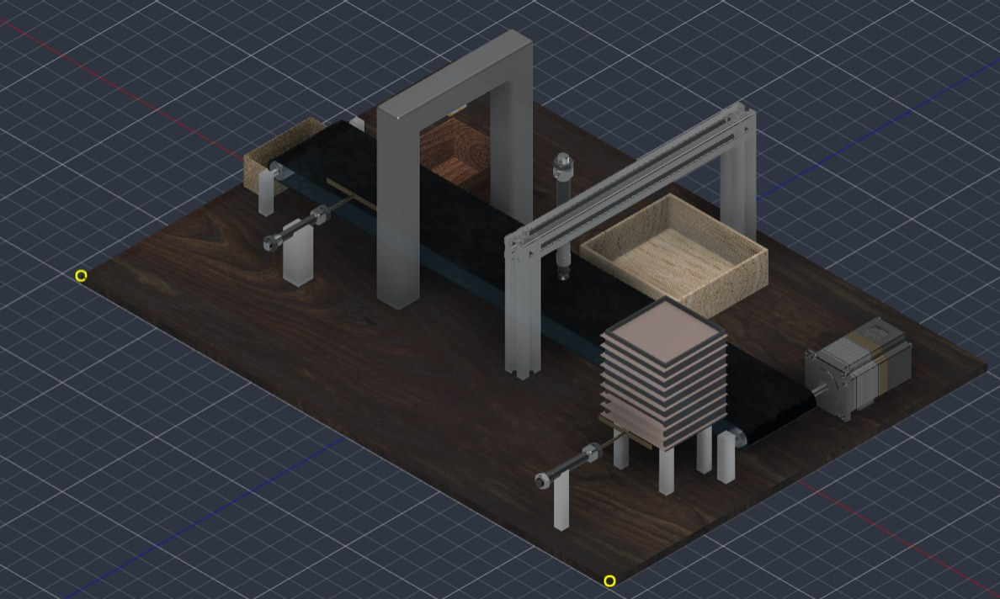
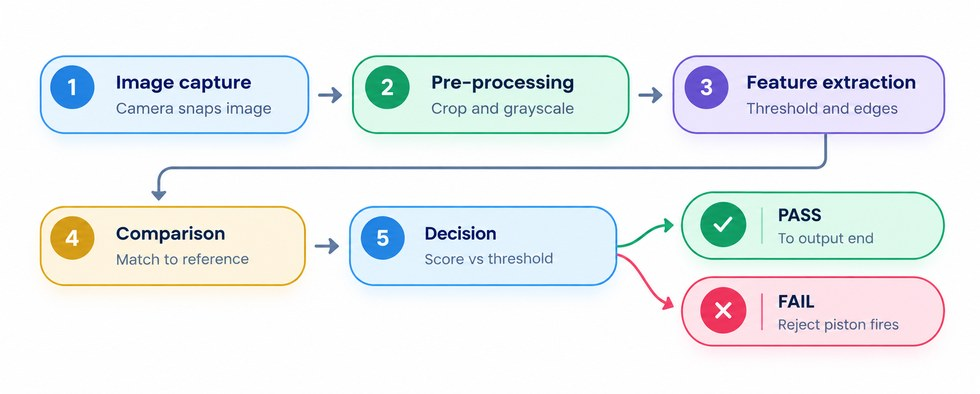
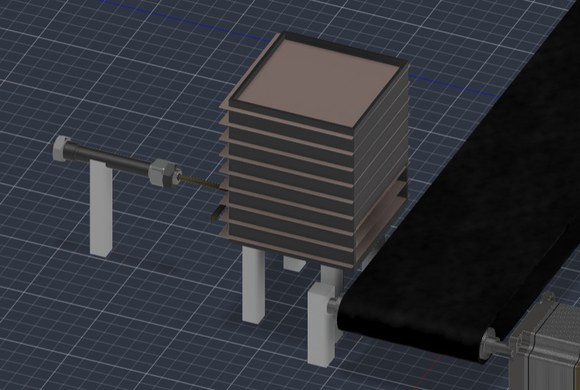
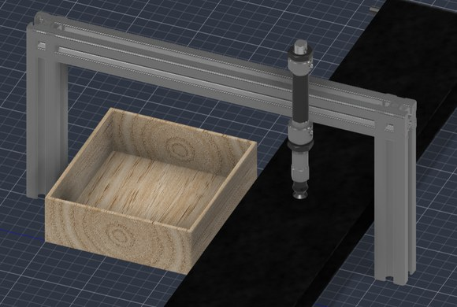
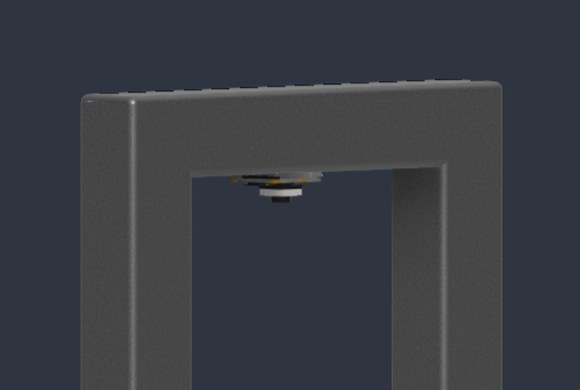
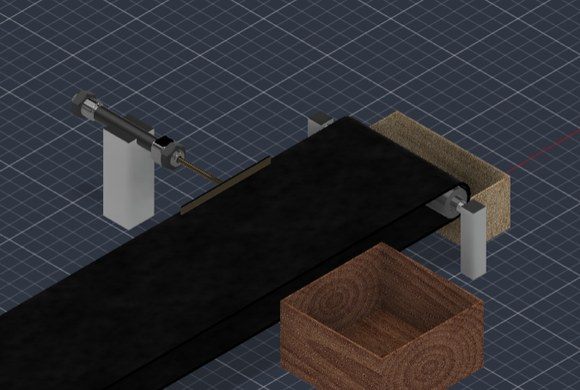
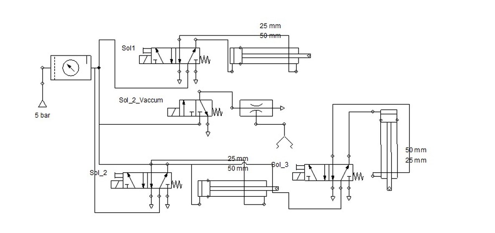
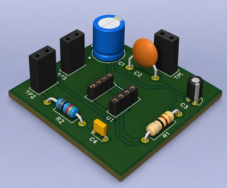
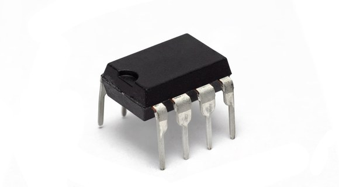

# Automated PCB Assembly & Vision Inspection Cell

A low-cost, locally built electro-pneumatic cell that feeds PCBs one at a time, places and presses an IC, inspects every board with an on-device camera, and sorts it into an **Accept** or **Reject** bin, logging every verdict.

**Team ID:** VK26-IITI-AHM-0072 | **Track:** AI in Hardware & Manufacturing | **Status:** Stage 2 (in progress)

## Problem

Small PCB assembly units inspect boards by eye. It is slow, differs between operators, causes fatigue errors, and leaves no record of why a board was rejected. Commercial AOI machines cost several lakhs to over a crore of rupees, which MSMEs cannot afford.

## Solution

A compact cell with simple parts (3 pistons, 1 conveyor motor, a few sensors, 1 camera):

1. **Feed**: a magazine and piston push out one PCB per stroke.
2. **Convey**: a belt with guide rails carries the board; an IR sensor ejects flipped boards.
3. **Assemble**: a vacuum nozzle picks the IC and a press piston seats the pins.
4. **Inspect**: a fixed camera under LED light checks IC presence, position and pin alignment.
5. **Sort**: PASS goes to the Accept bin; FAIL is pushed into the Reject bin and logged.

**Targets:** about 5–6 s per board, under 1 s inference on-device (no network), and 100% of boards logged with verdict, defect type and annotated image.

## How it works

- **PLC** runs the cycle logic, interlocks, valves and motor.
- **Raspberry Pi 5 + camera** runs OpenCV inspection and logging, then sends PASS/FAIL to the PLC.

## Main hardware

| Part | Choice |
|---|---|
| Controller | PLC with digital I/O |
| Vision | Raspberry Pi 5, camera module, LED light, OpenCV (optional INT8 YOLOv8-n) |
| Actuation | Double-acting pneumatic cylinders, solenoid valves, 5 bar supply, vacuum generator |
| Sensors | E18-D80NK IR proximity sensor |
| Conveyor | Belt, roller shafts, pillow-block bearings, drive motor |
| Structure | Aluminium / mild-steel frame and base plate (locally fabricated) |

All parts are standard and locally available.

## CAD design

| Magazine feeder | Pick-and-place gantry |
|---|---|
|  |  |

| Vision arch | Reject piston and bins |
|---|---|
|  |  |

## Electro-pneumatic circuit

## Test board and IC

| PCB | 555 Timer IC |
|---|---|
|  |  |

## Safety

- Enclosed work area so operators cannot reach moving parts
- Emergency stop that cuts PLC outputs and vents air (planned)
- Sensors prevent jams, misloads and unseated boards
- Standards considered: ISO 4414, IEC 60204-1, ISO 13850

## Roadmap

| Month | Focus |
|---|---|
| 1 | Tune vision pipeline; build frame, camera arch and lighting |
| 2 | Build feeder, conveyor, gantry, press piston and pneumatics |
| 3 | Integrate PLC, sensors and vision; calibrate PASS/FAIL thresholds |
| 4 | Measure accuracy and cycle time; build dashboard; prepare Stage 3 demo |

**Future scope:** multi-station lines, new boards/ICs with a new reference image, a fleet dashboard, and retraining the model for bare-board defects (mouse bites, opens, shorts, spurs).

## Team

- _Hariharasudhan D, Sivapiriyan A R, Sridarshan A, Adhavan M_
- _Sri Ramakrishna Engineering College_

